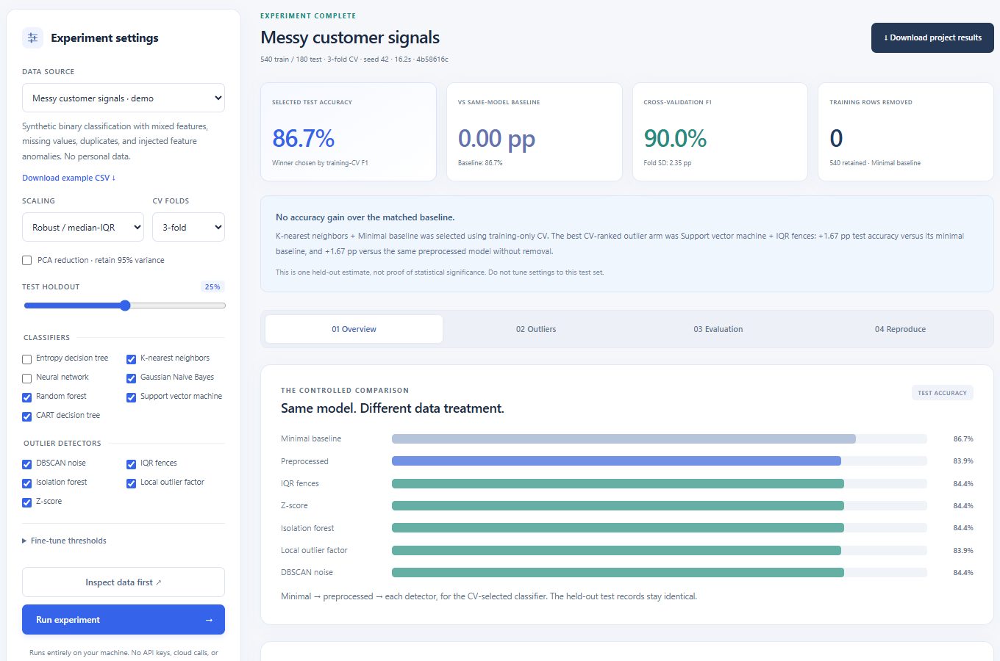
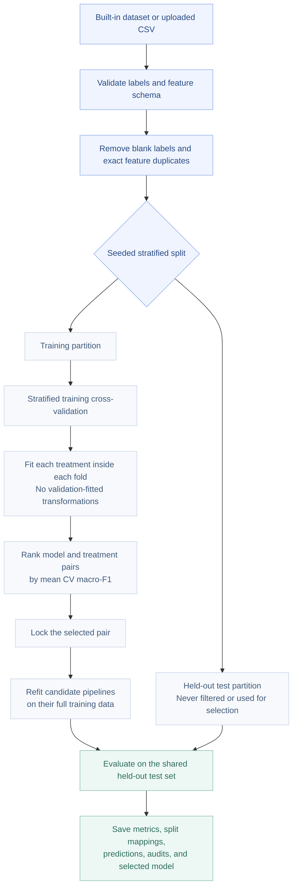
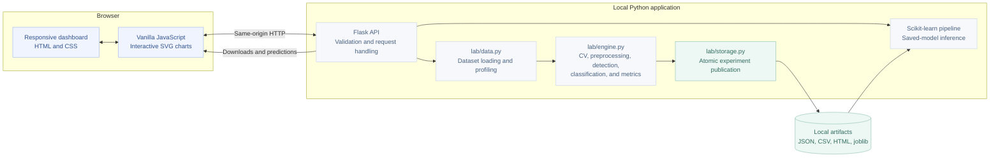

<div align="center">

# DataPrep Lab

### Data quality. Controlled experiments. Measurable evidence.

A local-first research workspace for **Data Preprocessing and Outlier Detection for Improving Classification Accuracy**.

[Overview](#overview) · [Quick start](#quick-start) · [Methodology](#experimental-methodology) · [Architecture](#architecture) · [Testing](#testing)

**7 classifiers** &nbsp; / &nbsp; **5 outlier detectors** &nbsp; / &nbsp; **4 built-in datasets**

</div>

---

## Overview

DataPrep Lab measures how preprocessing and outlier removal affect classification performance. Rather than assuming that cleaner-looking data must produce a better model, it evaluates three treatment stages under the same validation protocol:

| Treatment | Processing | Research question |
|:--|:--|:--|
| **A · Minimal baseline** | Median/mode imputation and one-hot encoding | How well does the classifier work without scaling or outlier removal? |
| **B · Preprocessed** | Baseline processing, numeric scaling, and optional PCA | What changes when feature transformation is added? |
| **C · Outlier-aware** | Training-only outlier detection and removal, followed by refitted preprocessing | Does removing candidate anomalies help or hurt the same classifier? |

The application provides a professional analytics dashboard, CSV inspection, fold-local model evaluation, interactive visualizations, saved experiments, and prediction with the selected pipeline. It runs locally without cloud services or API keys.

> **Research principle:** outliers are not automatically errors. The project preserves positive, negative, and zero gains, and reports unsafe filtering configurations instead of silently substituting another method.

## Workspace preview



*The interface uses synthetic demonstration data. The small scatter illustration in the header is illustrative, not an experiment result.*

## Key capabilities

| Area | What is included |
|:--|:--|
| **Dataset inspection** | Missing-value counts, duplicate detection, class counts, feature types, and cardinality checks |
| **Preprocessing** | Numeric median imputation, categorical mode imputation, unknown-category-safe one-hot encoding |
| **Feature transformation** | Robust, standard, or min–max numeric scaling; optional 95%-variance PCA |
| **Outlier analysis** | Statistical, isolation-based, proximity-based, and density-clustering approaches |
| **Controlled comparison** | Shared stratified holdout and training-only cross-validation across every model/treatment arm |
| **Visualization** | Treatment accuracy bars, sortable model comparison, PCA scatter, class-retention analysis, distribution summaries, correlation map, confusion matrix, and binary ROC curve |
| **Prediction** | New JSON records processed through the saved selected pipeline |
| **Reproducibility** | Saved settings, package versions, split indices, original-record mappings, fold scores, predictions, and model files |
| **Local operation** | No database setup, external frontend assets, paid APIs, or Node.js runtime required |

## Quick start

### Requirements

- **Python 3.11**: the verified Python version.
- **Windows PowerShell or Command Prompt**: launchers are included for Windows.
- Internet access for the initial Python dependency installation.

Microsoft Edge and the optional Playwright dependency are required only for the browser verification script, not for using the application.

### Clone and launch

```powershell
git clone https://github.com/thirumani-vihaan/pre-processor.git
cd pre-processor
.\DataPrep-Outlier-Lab\Launch.cmd
```

Open **http://127.0.0.1:5080** in your browser. Keep the application terminal open; use **Ctrl+C** to stop the server.

The launcher creates a project-local virtual environment and installs the runtime dependencies when the environment does not exist.

### PowerShell alternative

```powershell
cd DataPrep-Outlier-Lab
.\start.ps1
```

To choose a different port:

```powershell
.\start.ps1 -Port 5081
```

### Manual installation

```powershell
cd DataPrep-Outlier-Lab
python -m venv .venv
.\.venv\Scripts\python.exe -m pip install -r requirements.txt
.\.venv\Scripts\python.exe app.py
```

Use `requirements-lock.txt` instead of `requirements.txt` to reinstall the exact recorded verification environment, including the optional development packages.

## A typical experiment

1. **Select data.** Start with the messy customer-signals demo, another built-in benchmark, or a CSV upload.
2. **Inspect the dataset.** Review feature types, missing cells, duplicate removal, and class counts.
3. **Configure the comparison.** Choose classifiers, outlier detectors, scaling, holdout size, and three or five CV folds.
4. **Run the experiment.** The application fits each treatment using training-only transformations.
5. **Review the evidence.** Compare CV scores, held-out metrics, detector behavior, and per-class removals.
6. **Export or predict.** Download the reproducibility bundle or submit new records to the selected pipeline.

Changing the detector in the visualization tab changes the **exploration view only**. It does not retrain the selected model or change its predictions. Model, processed-training, and training-audit exports belong to the **CV-selected treatment**, which may legitimately be the minimal baseline.

## Experimental methodology



### Leakage safeguards

- All methods share the same seeded stratified train/test indices.
- Each CV fold fits its own imputation, encoding, scaling, optional PCA, and outlier detection using only that fold's training subset.
- Detectors operate on **numeric features without target labels**.
- Only training rows are removed. Validation and test records remain intact.
- After filtering, classifier preprocessing is fitted again on the retained training rows.
- The selected model/treatment pair is determined by **mean training-CV macro-F1 before held-out predictions are evaluated**.
- Numeric medians, category modes, scaler parameters, PCA components, and detector thresholds are never learned from the test partition.

The minimal baseline still imputes and encodes: most supported classifiers cannot consume missing values and categorical strings directly.

### Interpreting improvement

The application distinguishes two comparisons:

| Comparison | Interpretation |
|:--|:--|
| Outlier-aware arm versus its **same-classifier minimal baseline** | Combined effect of preprocessing and filtering |
| Outlier-aware arm versus its **same-classifier preprocessed arm** | Added effect of outlier removal |

The displayed overall winner is selected by CV performance, **not** by the largest observed test gain. The remaining test results are exploratory; do not repeatedly tune settings against them.

## Architecture



**Technology stack:** Python, Flask, scikit-learn, pandas, NumPy, joblib, HTML, CSS, and JavaScript. Pytest and Playwright provide automated verification.

## Implemented algorithms

### Classification

| Classifier | Implementation details |
|:--|:--|
| CART-style decision tree | Gini criterion; maximum depth 7; minimum 3 samples per leaf |
| Entropy decision tree | Entropy criterion; maximum depth 7; minimum 3 samples per leaf |
| Gaussian Naive Bayes | Gaussian feature likelihoods |
| K-nearest neighbors | Five neighbors; distance weighting |
| Support vector machine | RBF kernel; `C=1`; probability estimation enabled |
| Random forest | 100 trees; minimum 2 samples per leaf |
| Neural network | MLP with 48- and 24-unit hidden layers; up to 400 iterations |

The default comparison selects five classifiers; the entropy tree and neural network can be enabled in the interface. The entropy tree is **not claimed to be an exact ID3 implementation**.

### Outlier detection

| Detector | Family | Main setting |
|:--|:--|:--|
| IQR fences | Statistical | Default multiplier: 2.5 |
| Z-score | Statistical | Default absolute threshold: 3.0 |
| Isolation forest | Isolation-based | Default expected contamination: 6% |
| Local outlier factor | Proximity/density-based | Up to 20 neighbors; default contamination: 6% |
| DBSCAN noise | Clustering-based | Default standardized-space `eps=2.0`; `min_samples=5` |

IQR and Z-score flag a row when any numeric feature breaches its threshold. Isolation forest, LOF, and DBSCAN use standardized numeric data. Expected contamination is a threshold-setting assumption, not verified anomaly ground truth.

### Filtering safeguards

A treatment is explicitly excluded if filtering would:

- Remove **more than half** of its training records.
- Leave **fewer than 20** training records.
- Eliminate a class.
- Leave **fewer than three** training examples in any class.

These checks prevent unusable fits; they do not establish fairness or prove that removed observations were erroneous.

## Datasets and CSV uploads

| Dataset | Source records | Features | Classes |
|:--|--:|:--|--:|
| Messy customer signals | 732, including 12 deliberate duplicates | 8 numeric + 2 categorical | 2 |
| Wisconsin breast cancer | 569 | 30 numeric | 2 |
| Wine recognition | 178 | 13 numeric | 3 |
| Iris flowers | 150 | 4 numeric | 3 |

The customer dataset is synthetic and reproducibly includes feature anomalies and missing values. Its labels are not deliberately corrupted. The other datasets are bundled scikit-learn benchmarks and do not require dataset downloads. Cleaning may reduce the source-record counts.

For a CSV:

- Use a comma-separated UTF-8 file with **unique, nonblank headers**.
- Select a target with **2–15 classes**.
- Keep at least **50 distinct labeled records** and **eight records per class**.
- Stay within **8 MB**, **5,000 rows**, and **60 input features**.
- Exclude identifiers, unrestricted text, and features derived from the target.
- Categorical features with more than **30 categories** are rejected.
- At least one numeric feature is needed for the outlier comparisons.

Missing labels are removed; conflicting labels for identical feature rows are rejected. Numeric infinities become missing values during dataset preparation. Numeric prediction inputs must be finite numbers or `null`.

> The breast-cancer benchmark is for educational evaluation only. This application is not a clinical or diagnostic tool.

## Evaluation and outputs

The dashboard reports accuracy, balanced accuracy, macro precision, macro recall, macro-F1, ROC-AUC, and confusion matrices. Binary datasets include an ROC curve with the positive class shown explicitly. Multiclass ROC-AUC uses macro one-vs-rest.

Each completed run is saved under:

```text
DataPrep-Outlier-Lab/
└── artifacts/
    └── <run-id>/
        ├── results.json
        ├── comparison.csv
        ├── predictions.csv
        ├── training_audit.csv
        ├── processed_training.csv
        ├── model.joblib
        └── report.html
```

| Artifact | Purpose |
|:--|:--|
| `results.json` | Configuration, environment versions, all metrics, fold scores, split mappings, warnings, and chart summaries |
| `comparison.csv` | Model/treatment comparison in tabular form |
| `predictions.csv` | Held-out inputs, actual/predicted labels, probabilities, and correctness |
| `training_audit.csv` | Selected treatment's training inputs, removal decisions, and anomaly scores |
| `processed_training.csv` | Retained training records after the selected fitted transformations |
| `model.joblib` | Selected preprocessing and classification pipeline |
| `report.html` | Standalone HTML experiment summary |

Exports use `source_row` for the **zero-based original data-record position, excluding the CSV header**. The full JSON separately includes cleaned-dataset split indices and original-record mappings.

Artifacts and uploaded CSVs remain local and are ignored by Git. Source columns in tabular exports are prefixed with `feature__` to avoid collisions with audit metadata.

## Testing

From the application directory:

```powershell
cd DataPrep-Outlier-Lab

# Unit and integration tests
.\.venv\Scripts\python.exe -m pytest -q

# Optional real-browser checks using installed Microsoft Edge
.\.venv\Scripts\python.exe -m pip install -r requirements-dev.txt
.\.venv\Scripts\python.exe tests\browser_check.py

# Reproducible saved demo without starting a server
.\.venv\Scripts\python.exe app.py --demo
```

The current automated suite contains **77 tests**, covering dataset validation, training-only imputation, held-out isolation, all classifiers, detector repeatability, original-row mapping, exports, prediction schemas, persistence, concurrent requests, and interrupted writes.

The browser check exercises CSV upload, experiments, all result tabs, predictions, completed downloads, history restoration, error states, documentation, and layouts at **320, 390, 768, 1024, and 1500 pixels**. Screenshots are written to the ignored `artifacts/screenshots` directory.

An additional verification matrix exercised **196 model/treatment configurations** across all four built-in datasets. Configurations rejected by filtering safeguards were reported explicitly, not treated as successful model fits.

## Repository structure

This repository contains the contents of the local hackathon folder. The application is intentionally kept in its own subdirectory.

```text
pre-processor/
├── README.md
├── .gitignore
├── docs/
│   └── assets/
│       └── workspace.png
└── DataPrep-Outlier-Lab/
    ├── app.py
    ├── Launch.cmd
    ├── start.ps1
    ├── requirements.txt
    ├── requirements-dev.txt
    ├── requirements-lock.txt
    ├── lab/
    │   ├── data.py
    │   ├── engine.py
    │   └── storage.py
    ├── static/
    │   ├── app.js
    │   └── style.css
    ├── templates/
    │   ├── index.html
    │   ├── guide.html
    │   └── report.html
    └── tests/
        ├── test_data.py
        ├── test_engine.py
        ├── test_app.py
        └── browser_check.py
```

## Academic scope

| Syllabus unit | Connection to the implementation |
|:--|:--|
| **Unit I** | KDD workflow, preprocessing, cleaning, transformation, and dimensionality reduction |
| **Unit II** | Background context only; no warehouse, OLAP cube, or attribute-oriented induction implementation is claimed |
| **Unit III** | Numeric correlation visualization; association-rule mining is outside this project's scope |
| **Unit IV** | Decision trees, Bayesian classification, KNN, backpropagation, SVM, and classifier evaluation |
| **Unit V** | Statistical, proximity/density-based, and clustering-based outlier analysis |

The architecture follows the pipeline-based implementation approach referenced in `DMFINAL.pdf`, while addressing a different research question. The reference PDF is not included in this repository.

## Limitations and responsible interpretation

- A single held-out split does not establish statistical significance or general superiority. Stronger claims require additional datasets, repeated evaluation, or nested CV.
- The split assumes independent records. Grouped, longitudinal, patient-level, and time-series data need an appropriate group-aware or time-aware evaluation design.
- Statistical and distance-based detectors may remove legitimate minority-class observations. Review the class-retention table and training audit.
- The detectors are numeric-only. Categorical features remain available to classification but do not directly enter anomaly detection.
- PCA is dimensionality reduction, not a specialized high-dimensional anomaly-detection solution.
- Contextual/collective anomaly modeling, continuous-target regression, association-rule mining, and data warehousing are not implemented.
- Neural-network convergence warnings are surfaced; a completed fit is not a guarantee of optimal training.
- The Flask server is a **localhost demonstration server**, not a production deployment.

## Privacy and credentials

The application does not require a GitHub token or any other API key. GitHub credentials are only relevant to Git operations and must stay in a credential manager, not in source code, remote URLs, screenshots, or `.env` files committed to this repository.

Uploaded CSVs, trained models, and result bundles can contain the supplied data. They are not automatically deleted. Avoid confidential data on shared machines, and review exports before sharing them.

Only load trusted, locally generated `.joblib` files. Model uploads are not accepted.

---

<div align="center">

**DataPrep Lab**<br>
An evidence-first workspace for data quality and classification research.

</div>
